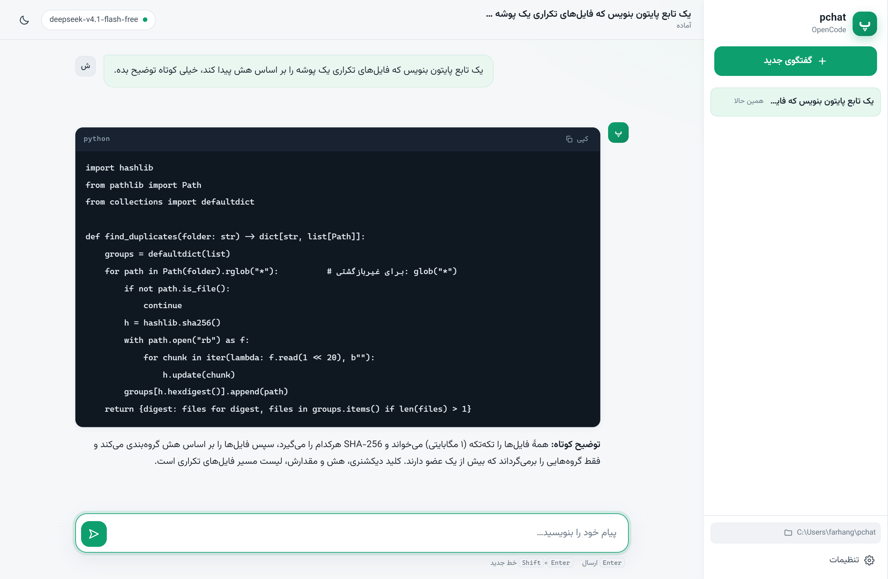
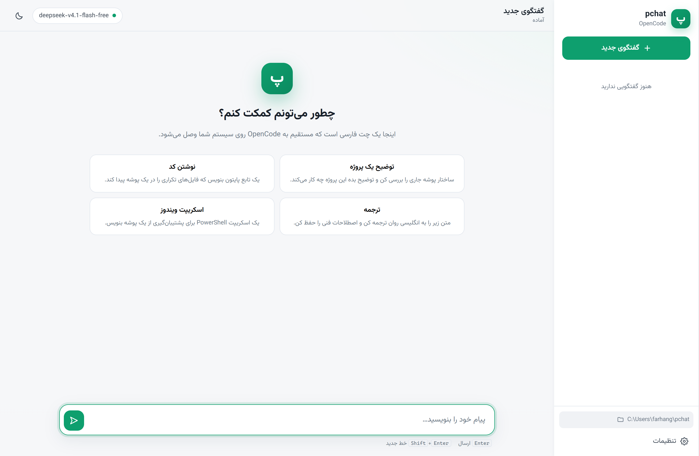
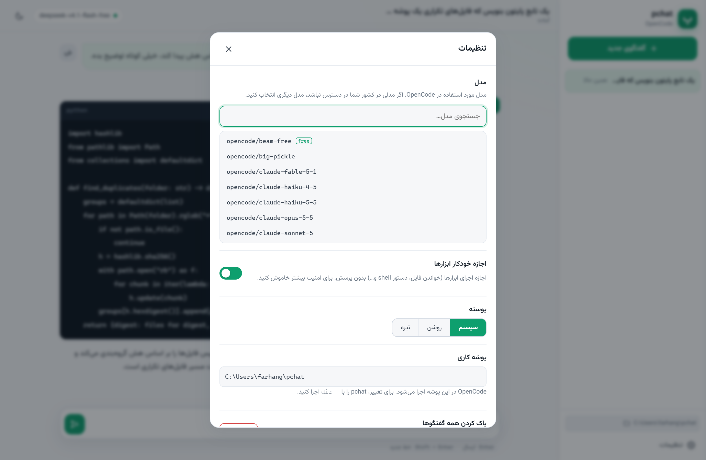
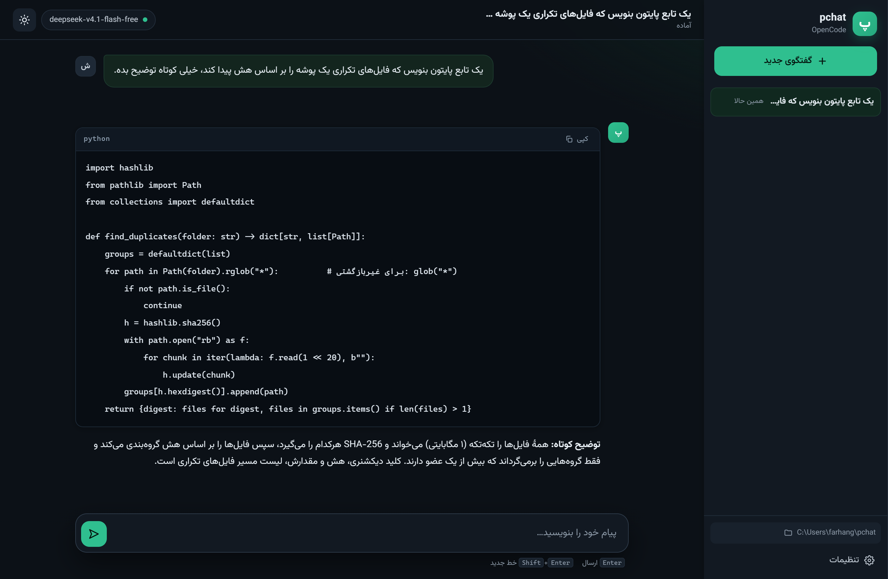
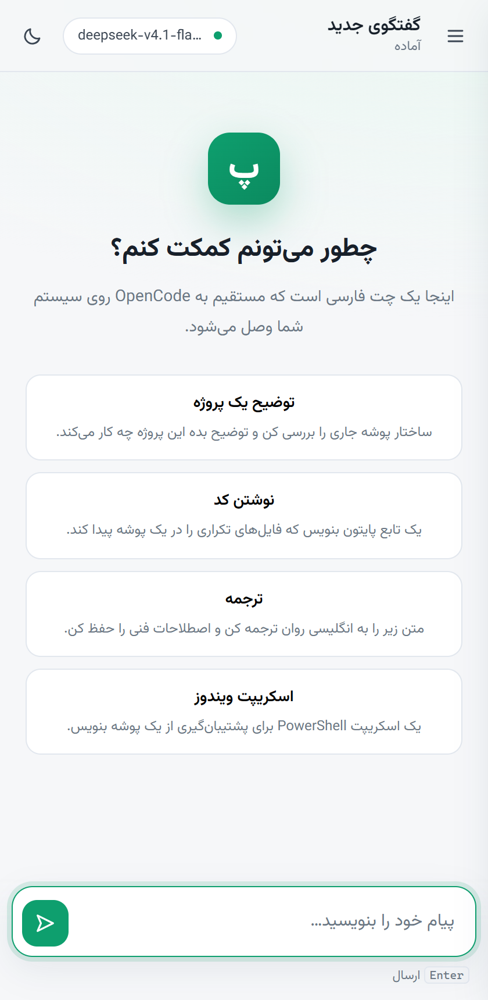
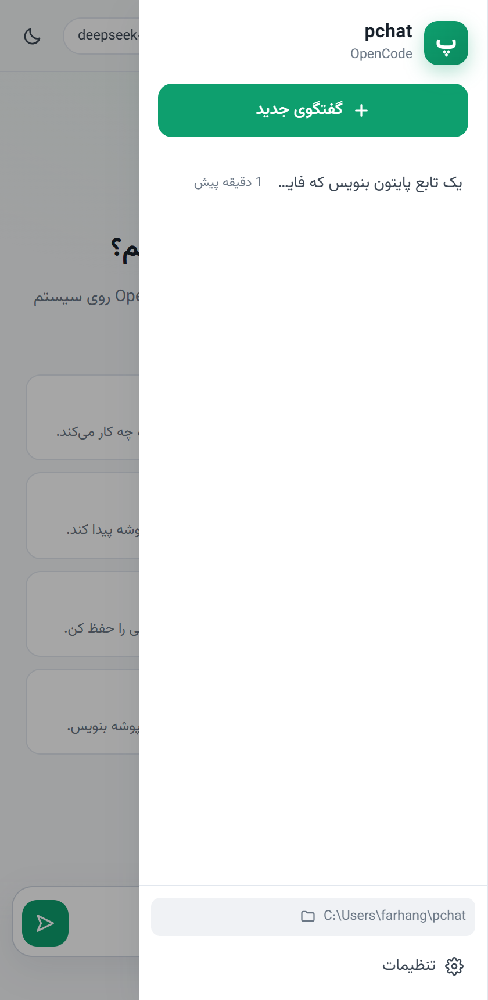

# pchat — چت فارسی و راست‌به‌چپ برای OpenCode

<p align="center">
  
</p>

<p align="center">
  <a href="LICENSE"></a>
  
  
  
</p>

**pchat** یک رابط وب محلی و کاملاً فارسی برای [OpenCode](https://opencode.ai) است. ظاهر آن شبیه
چت‌های مدرن (مثل ChatGPT) است، اما مدل، ابزارها، نشست‌ها و تنظیمات همه از خودِ OpenCode روی
سیستم شما می‌آیند؛ pchat فقط یک لایهٔ نمایش فارسی و راست‌به‌چپ روی آن است.

---

## چرا pchat؟ (چرا نه `cmd`؟)

مشکل ترمینال ویندوز فقط «فونت» نیست؛ دو مشکل بنیادی دارد:

| مشکل | توضیح |
| --- | --- |
| کدپیج | کنسول ویندوز به‌طور پیش‌فرض روی کدپیج ۴۳۷ است، پس متن فارسی پیش از رسیدن به صفحه به `????` تبدیل می‌شود. |
| الگوریتم دوجهته (bidi) | حتی با UTF-8، کنسول ویندوز bidi ندارد؛ خطوطی که فارسی و انگلیسی را قاطی می‌کنند به‌هم می‌ریزند. |

مرورگر هر دو را دارد: UTF-8 و پیاده‌سازی کامل bidi. بنابراین در pchat:

- فارسی درست شکل می‌گیرد (فونت **وزیرمتن** به‌صورت محلی همراه پروژه است، بدون نیاز به اینترنت).
- ترکیب فارسی و انگلیسی، اعداد، پرانتز و علامت نقل‌قول درست چیده می‌شود.
- بلوک‌های کد همیشه چپ‌به‌راست و چپ‌چین می‌مانند، با دکمهٔ کپی.
- Markdown کامل (تیتر، فهرست، جدول، نقل‌قول، لینک) رندر می‌شود.

---

## امکانات

| امکان | توضیح |
| --- | --- |
| 🗨️ چت فارسی RTL | حباب پیام، فونت وزیرمتن، جهت‌دهی خودکار برای متن‌های انگلیسی |
| ⚡ پاسخ زنده | متن پاسخ به‌صورت جریان (stream) تایپ می‌شود |
| 🧰 نمایش ابزارها | هر `read` / `write` / `shell` / `grep` … با مسیر یا دستور و وضعیت زنده |
| ⏹️ توقف پاسخ | دکمهٔ توقف یا `Esc`؛ پاسخ نیمه‌کاره به‌عنوان «متوقف‌شده» ذخیره می‌شود |
| 🗂️ تاریخچهٔ گفتگو | نوار کناری، عنوان خودکار، تغییر نام با دوبار کلیک، حذف |
| 🔁 تداوم نشست | شناسهٔ واقعی نشست OpenCode ذخیره می‌شود (`opencode -s <id>` هم همان را ادامه می‌دهد) |
| 🎛️ انتخاب مدل | فهرست همهٔ مدل‌های OpenCode با جستجو؛ انتخابتان ذخیره می‌شود |
| 🌗 پوسته | روشن / تیره / مطابق سیستم |
| 🈯 خطاهای فارسی | خطاهای واقعی OpenCode (منطقه، موجودی، شبکه…) به فارسی توضیح داده می‌شوند |
| ✅ مجوز خودکار | کلید `--auto` برای اجرای ابزارها بدون پرسش (قابل خاموش کردن) |
| 📴 کاملاً محلی | سرور فقط روی `127.0.0.1` گوش می‌دهد؛ هیچ داده‌ای بیرون نمی‌رود |

---

## تصاویر

| صفحهٔ خوش‌آمد | گفتگو با بلوک کد |
| :---: | :---: |
|  |  |

| تنظیمات و انتخاب مدل | پوستهٔ تیره |
| :---: | :---: |
|  |  |

<p align="center">
  
  
</p>

---

## پیش‌نیازها

1. **Node.js 18 یا بالاتر** — [nodejs.org](https://nodejs.org)
2. **OpenCode** نصب‌شده و یک بار وارد‌شده (`opencode` باید در `PATH` باشد)

بررسی سریع:

```bat
node -v
opencode --version
```

---

## نصب

### روش ۱: بدون git (ساده‌ترین)

1. از بالای همین صفحه **Code → Download ZIP** را بزنید.
2. فایل را در مسیری مثل `C:\pchat` استخراج کنید.
3. روی **`pchat.cmd`** دوبار کلیک کنید.

> هیچ `npm install`ی لازم نیست؛ فایل‌های کتابخانه و فونت از قبل داخل `public/vendor` و
> `public/fonts` قرار دارند.

### روش ۲: با git

```bat
git clone https://github.com/erfan138057/pchat.git
cd pchat
pchat.cmd
```

### ساخت دستور سراسری `pchat` (اختیاری)

اگر می‌خواهید از هر پوشه‌ای در cmd یا PowerShell فقط `pchat` را تایپ کنید:

```bat
install.cmd
```

این اسکریپت یک شیم (`pchat.cmd`) در `%APPDATA%\npm` می‌سازد که به همین پوشه اشاره می‌کند.
برای حذف، همان فایل `%APPDATA%\npm\pchat.cmd` را پاک کنید.

---

## اجرا

```bat
pchat.cmd
```

مرورگر خودکار باز می‌شود و آدرس `http://127.0.0.1:5178` نمایش داده می‌شود.
پنجرهٔ کنسول را تا وقتی چت می‌کنید باز نگه دارید؛ بستن آن سرور را متوقف می‌کند.

### اجرا در یک پروژهٔ خاص

OpenCode در پوشهٔ جاری اجرا می‌شود. برای اینکه روی پروژهٔ خودتان کار کند:

```bat
pchat.cmd --dir C:\path\to\my-project
```

یا در ویندوز، **پوشه را روی `pchat.cmd` بکشید و رها کنید**.

### گزینه‌ها

```bat
pchat.cmd --help
```

| گزینه | پیش‌فرض | توضیح |
| --- | --- | --- |
| `--dir <path>` | پوشهٔ جاری | پوشه‌ای که OpenCode در آن اجرا می‌شود |
| `--port <n>` | `5178` | پورت سرور؛ اگر اشغال باشد خودکار یکی اضافه می‌شود |
| `--host <addr>` | `127.0.0.1` | آدرس اتصال |
| `--model <id>` | مدل ذخیره‌شده | مدل پیش‌فرض، مثل `opencode/deepseek-v4.1-flash-free` |
| `--no-open` | — | باز نکردن خودکار مرورگر |

---

## استفاده

- **Enter** ارسال، **Shift+Enter** خط جدید، **Esc** توقف پاسخ.
- **گفتگوی جدید** برای شروع چت تازه.
- کلیک روی **مدل** در نوار بالا یا **تنظیمات** برای تغییر مدل و پوسته.
- دوبار کلیک روی عنوان گفتگو در نوار کناری برای تغییر نام.
- پاسخ‌های Markdown پشتیبانی می‌شوند؛ بلوک کد با دکمهٔ کپی و چیدمان چپ‌به‌راست.

---

## ساختار پروژه

```
pchat/
├── bin/pchat.js          # ورودی خط فرمان: آرگومان‌ها، پورت، باز کردن مرورگر
├── src/
│   ├── server.js         # سرور HTTP، API، جریان NDJSON به مرورگر
│   ├── opencode.js       # پیدا کردن opencode و اجرای `opencode run`
│   └── store.js          # ذخیرهٔ گفتگوها و تنظیمات در JSON
├── public/
│   ├── index.html        # ساختار صفحه (dir="rtl" lang="fa")
│   ├── styles.css        # طراحی روشن/تیره، RTL، بلوک کد LTR
│   ├── app.js            # منطق رابط: جریان، Markdown، نشست‌ها، تنظیمات
│   ├── vendor/           # marked + DOMPurify (بدون CDN)
│   └── fonts/            # وزیرمتن (بدون CDN)
├── scripts/vendor.js     # کپی کتابخانه‌ها از node_modules به public
├── pchat.cmd             # اجرای سریع در ویندوز
├── install.cmd           # ساخت دستور سراسری pchat
└── docs/screenshots/     # تصاویر مستندات
```

---

## نحوهٔ کار

```
┌──────────┐   HTTP (NDJSON)   ┌───────────────┐   spawn   ┌──────────────────────────┐
│ مرورگر   │ ◄───────────────► │ سرور pchat    │ ────────► │ opencode run --format json│
│ (فارسی)  │                   │ (Node.js)     │ ◄──────── │ -m <model> -s <session>   │
└──────────┘                   └───────────────┘   stdout  └──────────────────────────┘
                                      │
                                      ▼
                              %USERPROFILE%\.pchat
```

برای هر پیام، سرور این دستور را اجرا می‌کند:

```
opencode run --format json -m <model> -s <session-id> --auto -- "<message>"
```

خروجی JSON خط‌به‌خط خوانده می‌شود و متن پاسخ، ابزارهای اجراشده، مصرف توکن و خطاها به‌صورت
زنده به مرورگر فرستاده می‌شوند. شناسهٔ نشست OpenCode ذخیره می‌شود تا پیام بعدی همان گفتگو را
ادامه دهد — یعنی می‌توانید همان نشست را در ترمینال هم با `opencode -s <id>` باز کنید.

**توجه:** احراز هویت، دسترسی مدل‌ها، ابزارها و مجوزها همه متعلق به OpenCode هستند. pchat چیزی
را شبیه‌سازی نمی‌کند؛ اگر OpenCode کاری را انجام ندهد، pchat هم نمی‌تواند.

---

## محل ذخیرهٔ داده‌ها

```
%USERPROFILE%\.pchat
├── settings.json          # مدل انتخابی، مجوز خودکار
└── sessions\
    └── chat_xxxx.json     # هر گفتگو + شناسهٔ نشست OpenCode
```

برای پاک کردن همه‌چیز: تنظیمات → «پاک کردن همه گفتگوها»، یا حذف پوشهٔ `.pchat`.
مسیر داده‌ها را می‌توان با متغیر محیطی `PCHAT_DATA_DIR` تغییر داد.

---

## عیب‌یابی

**OpenCode پیدا نشد.**
اگر `opencode` در `PATH` نیست، مسیر فایل اجرایی را بدهید:

```bat
set PCHAT_OPENCODE=C:\path\to\opencode.exe
pchat.cmd
```

**«این مدل در کشور شما در دسترس نیست» یا «موجودی حساب کافی نیست».**
این خطای واقعی OpenCode است. از تنظیمات مدل دیگری انتخاب کنید؛ مدل‌های دارای پسوند `free`
معمولاً در دسترس‌ترند (مثل `opencode/deepseek-v4.1-flash-free`).

**پورت اشغال است.**
pchat خودش پورت بعدی را امتحان می‌کند، یا با `--port 6000` پورت دیگری بدهید.

**خطای `running scripts is disabled` در PowerShell.**
این خطا مربوط به فایل‌های `.ps1` است؛ `pchat.cmd` از `.cmd` استفاده می‌کند و مشکلی ندارد.
اگر `opencode` یا `npm` هم همین خطا را می‌دهند، یک بار اجرا کنید:

```powershell
Set-ExecutionPolicy -Scope CurrentUser RemoteSigned
```

**فارسی در مرورگر درست نیست.**
فونت وزیرمتن همراه پروژه است؛ اگر صفحه را با zoom یا فونت اجباری مرورگر تغییر داده‌اید، آن را
برگردانید. به اینترنت نیازی نیست.

---

## توسعه

فایل‌های `public/vendor` و `public/fonts` از پیش ساخته شده‌اند. برای به‌روزرسانی کتابخانه‌ها:

```bat
npm install
npm run vendor
```

بررسی سریع نحو فایل‌ها:

```bat
node --check bin\pchat.js
node --check src\server.js
node --check public\app.js
```

بدون هیچ وابستگی زمان اجرا، سرور فقط با Node.js اجرا می‌شود.

---

## امنیت

- سرور به‌طور پیش‌فرض فقط روی `127.0.0.1` گوش می‌دهد؛ از شبکهٔ محلی قابل دسترسی نیست.
- با `--host 0.0.0.0` آن را باز نکنید مگر اینکه بدانید چه می‌کنید.
- گزینهٔ «مجوز خودکار» (`--auto`) اجازهٔ اجرای ابزارها را بدون تأیید می‌دهد؛ برای کارهای حساس
  خاموشش کنید.
- هیچ کلید API یا توکنی در این پروژه ذخیره نمی‌شود؛ احراز هویت را OpenCode مدیریت می‌کند.

---

## مجوز

[MIT](LICENSE)
